<p align="center">
  <picture>
    <source media="(prefers-color-scheme: dark)" srcset="docs/media/banner-en-dark.png">
    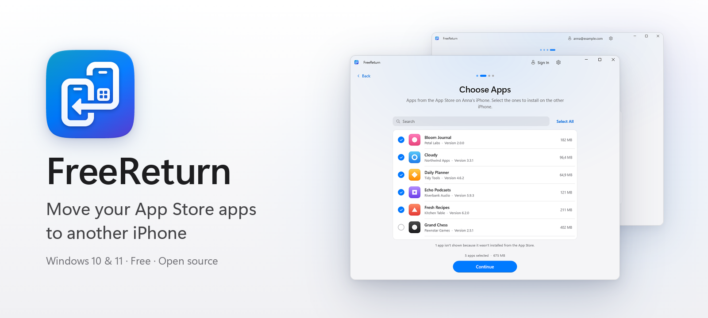
  </picture>
</p>

<p align="center">
  <a href="https://github.com/kr0nsch/AppBridge/releases/latest"></a>
</p>

<p align="center">
  <a href="https://github.com/kr0nsch/AppBridge/actions/workflows/ci.yml"></a>
  
  <a href="LICENSE"></a>
  <a href="https://github.com/kr0nsch/AppBridge/releases"></a>
  <a href="README.md"></a>
</p>

**AppBridge** moves your App Store apps from one iPhone to another, right from a Windows PC. Connect both phones, tick the apps you want and press Install: AppBridge downloads the original apps from Apple with your Apple Account and installs them over USB. No new iPhone yet? Save the apps to your PC now and install them later. Free, no jailbreak, no ads.

<p align="center">
  <picture>
    <source media="(prefers-color-scheme: dark)" srcset="docs/media/demo-en-dark.gif">
    
  </picture>
  <br>
  <sub>Recorded in demo mode with simulated iPhones and apps.</sub>
</p>

## How it works

On the first screen, choose **Transfer Now** when both iPhones are at hand, or **Transfer Later** when the new phone comes later.

### Transfer Now

1. **Connect the iPhone with your apps.** AppBridge lists every app installed from the App Store.
2. **Pick the apps.** Search and Select All are there when you need them.
3. **Connect the other iPhone.** Keep both plugged in or swap them one after the other.
4. **Sign in to the App Store and press Install.** The next app downloads while the previous one installs.

<p align="center">
  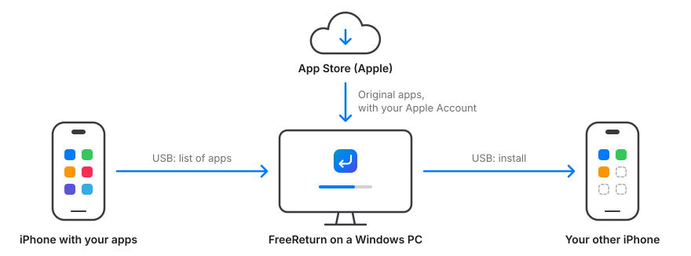
</p>

### Transfer Later

Two steps, as far apart as you like:

1. **Save Apps.** Connect the old iPhone, tick the apps and sign in to the App Store. AppBridge downloads them to `Downloads\AppBridge`. This is also a way to keep apps that may disappear from the App Store.
2. **Install on New iPhone.** Connect the new phone and AppBridge lists the saved apps: what is already installed, what gets updated and what won't run (for example, when it needs a newer iOS). You don't sign in to your Apple Account on the PC for this step.

<p align="center">
  <picture>
    <source media="(prefers-color-scheme: dark)" srcset="docs/media/later-en-dark.gif">
    
  </picture>
</p>

## Screenshots

<table>
  <tr>
    <td width="33%" align="center">
      <picture>
        <source media="(prefers-color-scheme: dark)" srcset="docs/screenshots/en-dark/1-connect.png">
        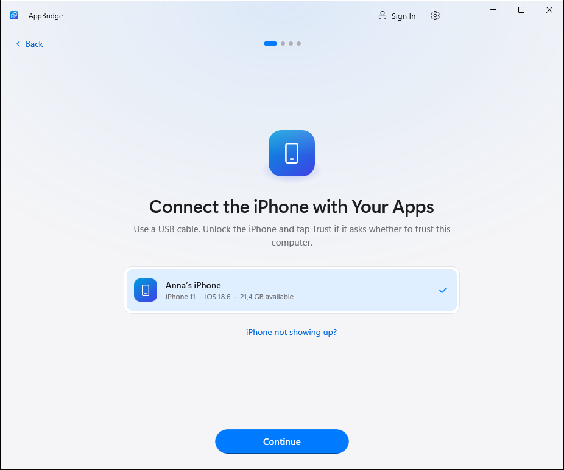
      </picture>
      <br><sub><b>Connect</b></sub>
    </td>
    <td width="33%" align="center">
      <picture>
        <source media="(prefers-color-scheme: dark)" srcset="docs/screenshots/en-dark/2-choose-apps.png">
        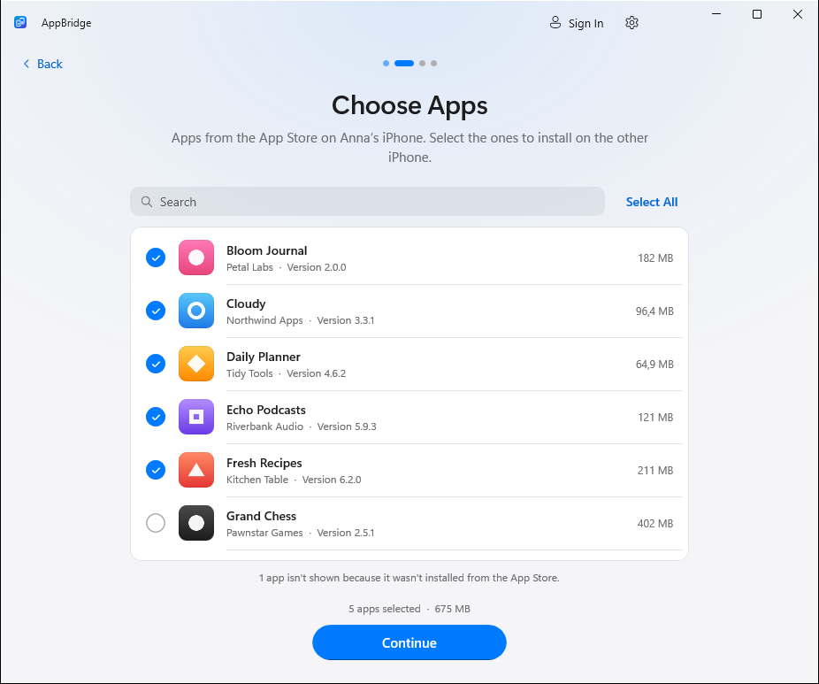
      </picture>
      <br><sub><b>Choose apps</b></sub>
    </td>
    <td width="33%" align="center">
      <picture>
        <source media="(prefers-color-scheme: dark)" srcset="docs/screenshots/en-dark/3-target.png">
        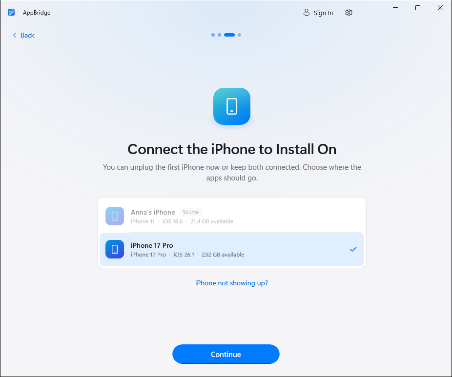
      </picture>
      <br><sub><b>Other iPhone</b></sub>
    </td>
  </tr>
  <tr>
    <td width="33%" align="center">
      <picture>
        <source media="(prefers-color-scheme: dark)" srcset="docs/screenshots/en-dark/5-ready.png">
        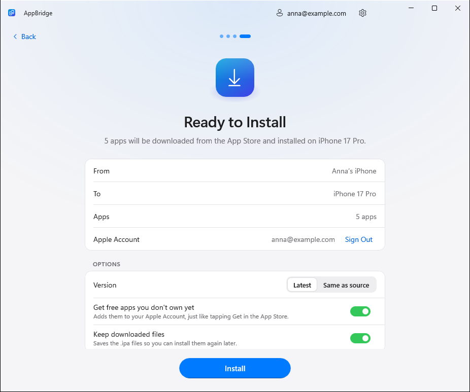
      </picture>
      <br><sub><b>Options</b></sub>
    </td>
    <td width="33%" align="center">
      <picture>
        <source media="(prefers-color-scheme: dark)" srcset="docs/screenshots/en-dark/6-installing.png">
        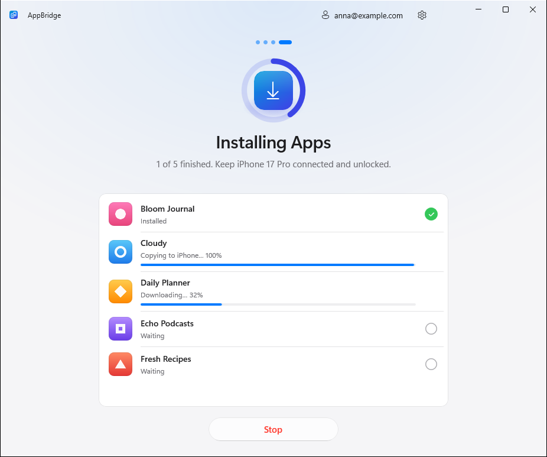
      </picture>
      <br><sub><b>Installing</b></sub>
    </td>
    <td width="33%" align="center">
      <picture>
        <source media="(prefers-color-scheme: dark)" srcset="docs/screenshots/en-dark/7-done.png">
        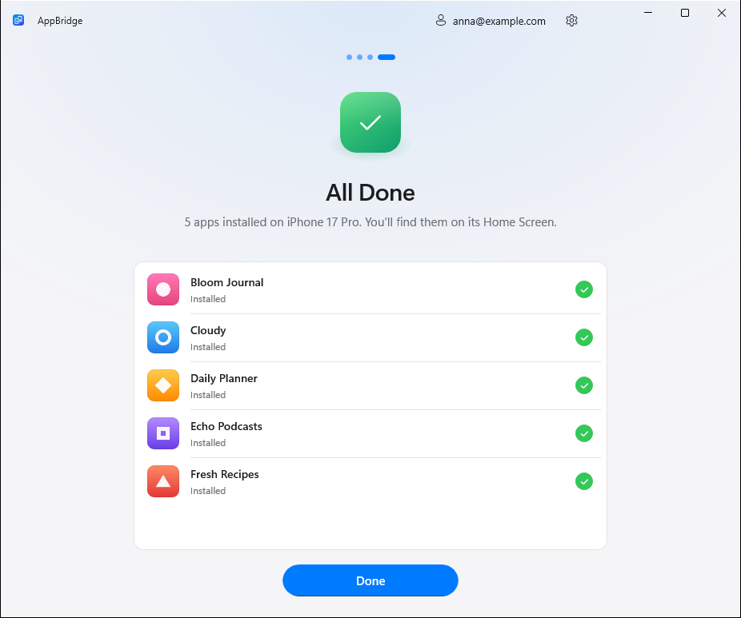
      </picture>
      <br><sub><b>Done</b></sub>
    </td>
  </tr>
</table>

**Transfer Later**

<table>
  <tr>
    <td width="33%" align="center">
      <picture>
        <source media="(prefers-color-scheme: dark)" srcset="docs/screenshots/en-dark/later-1-start.png">
        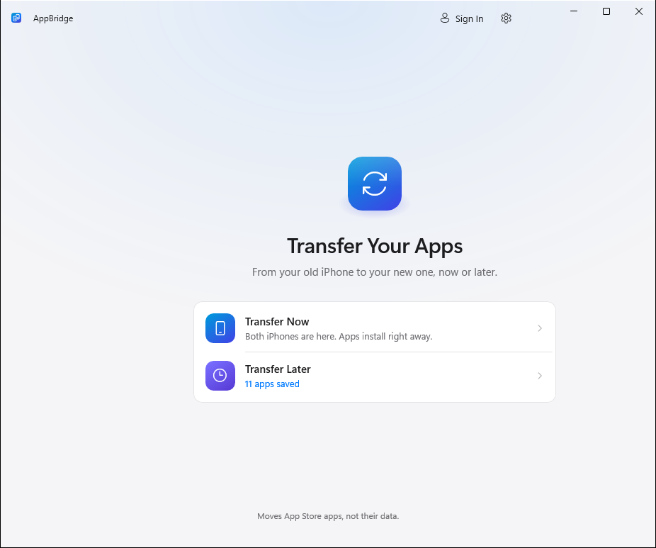
      </picture>
      <br><sub><b>Start</b></sub>
    </td>
    <td width="33%" align="center">
      <picture>
        <source media="(prefers-color-scheme: dark)" srcset="docs/screenshots/en-dark/later-2-hub.png">
        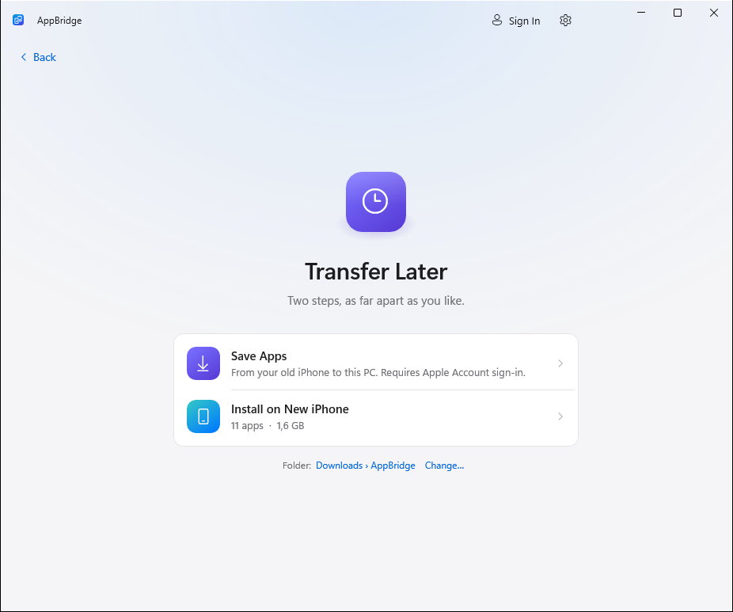
      </picture>
      <br><sub><b>Transfer Later</b></sub>
    </td>
    <td width="33%" align="center">
      <picture>
        <source media="(prefers-color-scheme: dark)" srcset="docs/screenshots/en-dark/save-3-done.png">
        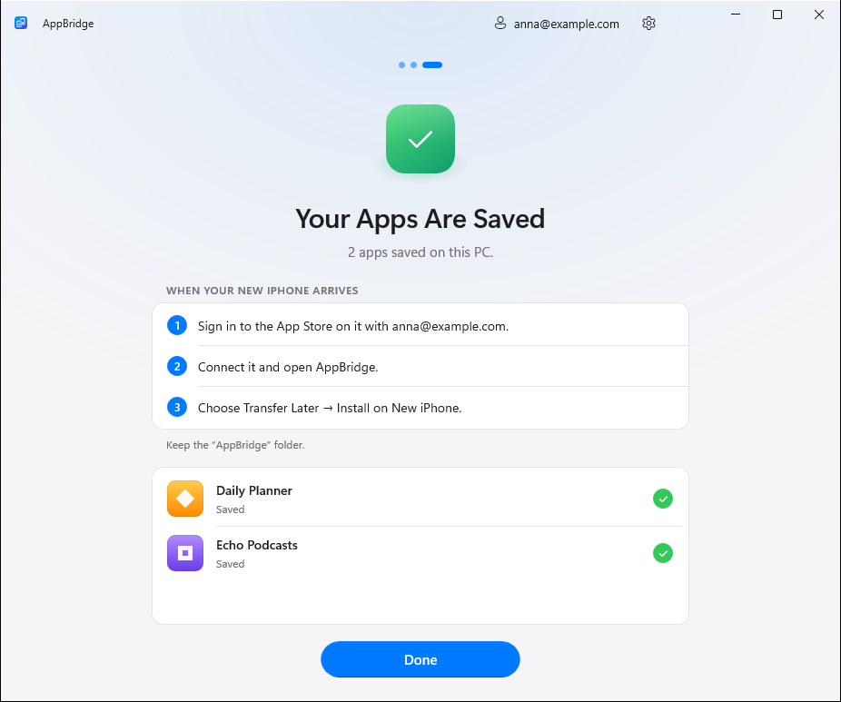
      </picture>
      <br><sub><b>Apps saved</b></sub>
    </td>
  </tr>
  <tr>
    <td width="33%" align="center">
      <picture>
        <source media="(prefers-color-scheme: dark)" srcset="docs/screenshots/en-dark/later-3-new-iphone.png">
        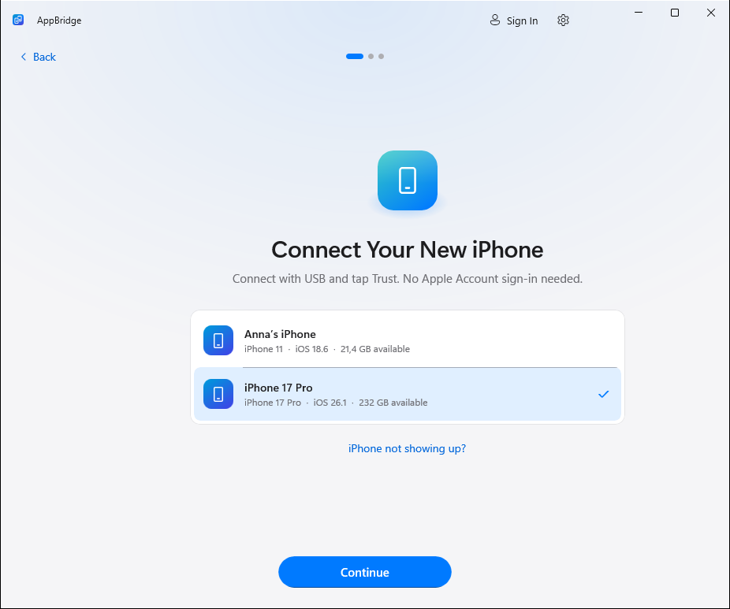
      </picture>
      <br><sub><b>New iPhone</b></sub>
    </td>
    <td width="33%" align="center">
      <picture>
        <source media="(prefers-color-scheme: dark)" srcset="docs/screenshots/en-dark/later-4-saved.png">
        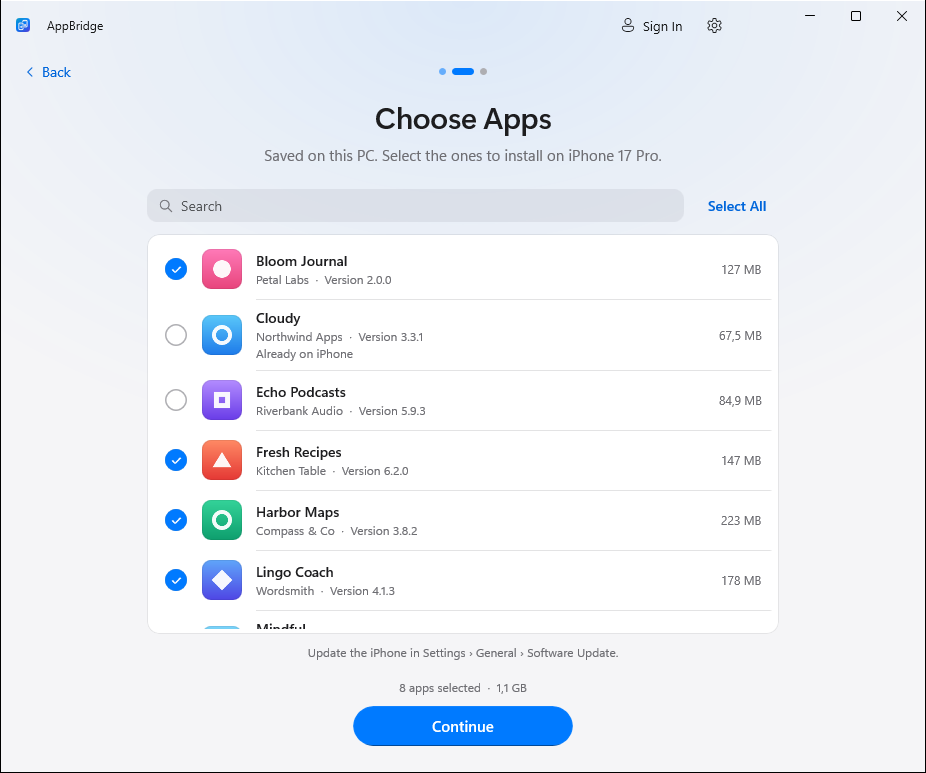
      </picture>
      <br><sub><b>Saved apps</b></sub>
    </td>
    <td width="33%" align="center">
      <picture>
        <source media="(prefers-color-scheme: dark)" srcset="docs/screenshots/en-dark/later-6-done.png">
        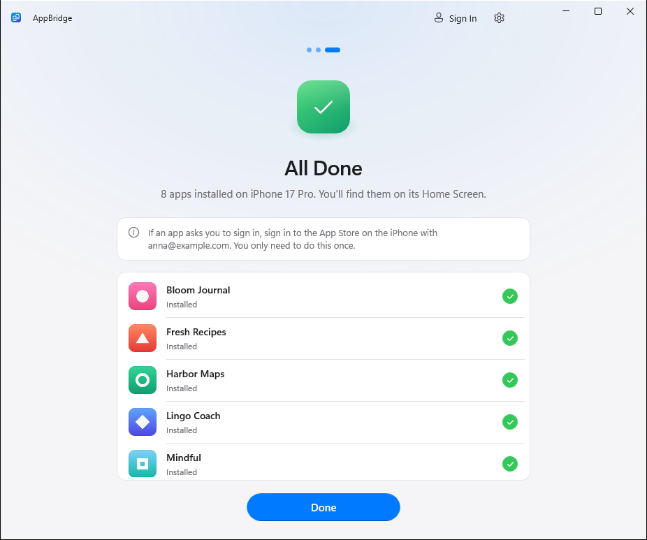
      </picture>
      <br><sub><b>Installed</b></sub>
    </td>
  </tr>
</table>

## Features

- **Four simple steps**, one button per screen.
- **Transfer now or later.** Save your apps to the PC while you still have the old iPhone and install them on the new one when it arrives, without signing in to your Apple Account on the PC. AppBridge picks the version that runs on the new phone's iOS.
- **Original apps from Apple.** Every app is downloaded from Apple's servers with your Apple Account — nothing comes from third-party sites.
- **All over USB.** No iTunes, Python or command line: AppBridge finds the iPhone, shows the "Trust This Computer?" prompt, reads the apps with their icons and installs them.
- **Fast.** Downloads and installs run side by side, every app shows its progress, and if one can't be installed you see why, with a Try Again button.
- **Your choice of version:** the latest from the App Store, or the same version as on the first iPhone (while Apple still offers it).
- **Free apps** can be added to your Apple Account automatically when they're not in your purchases yet.
- **Light and dark mode, English and Russian.**
- **Installer and portable version.** Nothing else to install: .NET and the Windows App SDK are included.

## Tested on real devices

| From | To | Apps | Result |
|---|---|---|---|
| iPhone 16 Pro | iPhone 14 | Sber, VK, Mail.ru Mail | ✅ Transferred |

Tried it on your devices? Tell us in the [issues](https://github.com/kr0nsch/AppBridge/issues) and we'll add it to the table.

## Download

Get the latest version from **[Releases](https://github.com/kr0nsch/AppBridge/releases/latest)**:

| File | What it is |
|---|---|
| `AppBridge-<version>-setup-x64.exe` | **Installer (recommended).** Installs for your user account, no administrator rights needed. Start menu shortcut, uninstall from Settings. |
| `AppBridge-<version>-portable-x64.zip` | **Portable version.** Unzip anywhere, even a USB stick, and run `AppBridge.exe`. Settings and downloads stay in the `Data` folder next to it. |
| `SHA256SUMS.txt` | Checksums to verify the files. |

**System requirements:** Windows 10 version 2004 or later, or Windows 11. x64 PCs; on Arm PCs, Windows 11 (through its built-in emulation).

> [!NOTE]
> Every release file is built by GitHub Actions straight from this repository and carries a signed build provenance attestation (Sigstore). Verify it with `gh attestation verify <file> -R kr0nsch/AppBridge`.
> There is no Authenticode certificate yet, so SmartScreen may warn about an unknown publisher — choose **More info → Run anyway**.

## What you need

- **The Apple Devices app** from the [Microsoft Store](https://apps.microsoft.com/detail/9NP83LWLPZ9K) (or iTunes). It contains the driver Windows uses to talk to iPhones; AppBridge tells you if it's missing.
- **A USB cable** that supports data, and both iPhones unlocked. Tap **Trust** when an iPhone asks whether to trust this computer.
- **The Apple Account** the apps were downloaded with (or one that can get them for free).
- An internet connection.

## FAQ

<details>
<summary><b>Does it move app data too?</b></summary>

No, AppBridge installs the apps themselves. Documents, chats and settings come back as usual — from iCloud, a backup, or by signing in inside the app.
</details>

<details>
<summary><b>Which apps can be moved?</b></summary>

The ones your Apple Account can get from the App Store. AppBridge can add free apps to your account for you, just like tapping Get in the App Store (you can turn this off). Paid apps must already be bought with that account. Apps pulled from the App Store can only be installed while Apple still serves them to their owners. Apps from outside the App Store (TestFlight, developer builds) aren't shown, because they can't be downloaded again.
</details>

<details>
<summary><b>I don't have the new iPhone yet. How do I transfer later?</b></summary>

Choose Transfer Later → Save Apps, connect the old iPhone and save the apps you want. When the new phone arrives, open AppBridge, choose Transfer Later → Install on New iPhone and connect it. For the apps to open, sign in to the App Store on the new iPhone with the Apple Account they were saved with. `.ipa` files kept by version 1.0 or copied into the folder are listed too.
</details>

<details>
<summary><b>Is it safe to enter my Apple Account password?</b></summary>

Your password is passed straight to the bundled, open-source [ipatool](https://github.com/majd/ipatool), which signs in to Apple. AppBridge never stores it, never logs it and never sends it anywhere else. The App Store session is stored encrypted, with the key protected by Windows (DPAPI) for your user account; Sign Out removes it. AppBridge has no servers, ads or telemetry. See [SECURITY.md](SECURITY.md).
</details>

<details>
<summary><b>Do I need a jailbreak? Does it bypass Apple's protection?</b></summary>

No and no. Apps are installed just like from the App Store and stay tied to your Apple Account (FairPlay protection is not bypassed).
</details>

<details>
<summary><b>The iPhone isn't listed</b></summary>

Use a cable that carries data, plugged straight into the PC, unlock the iPhone and make sure the Apple Devices app is installed. Try another USB port.
</details>

<details>
<summary><b>"Tap Trust on the iPhone" doesn't go away</b></summary>

Unlock the iPhone — the prompt only appears on an unlocked screen. If you tapped Don't Trust, press Try Again or replug the cable.
</details>

<details>
<summary><b>"Not in this Apple Account's purchases"</b></summary>

The app was downloaded with a different Apple Account. Sign in with that account, or turn on "Get free apps you don't own yet" (for free apps).
</details>

<details>
<summary><b>Where does AppBridge keep its data?</b></summary>

| | Installer | Portable |
|---|---|---|
| Settings, logs, App Store session | `%LOCALAPPDATA%\AppBridge` | `Data\` next to `AppBridge.exe` |
| Downloaded and saved apps (`.ipa`) | `Downloads\AppBridge` (changeable in Settings) | `Data\Downloads` |
| Icons of saved apps | `%LOCALAPPDATA%\AppBridge\Icons` | `Data\Icons` |

Downloaded `.ipa` files contain your Apple Account email (Apple adds it to every purchase) — don't share them.
</details>

<details>
<summary><b>Something went wrong</b></summary>

Open **Settings → Diagnostic logs → Show** and attach the latest log to an [issue](https://github.com/kr0nsch/AppBridge/issues/new/choose). Logs contain no passwords or codes.
</details>

## Building from source

You need Windows 10/11, the [.NET 10 SDK](https://dotnet.microsoft.com/download/dotnet/10.0), and [Inno Setup 6](https://jrsoftware.org/isinfo.php) for the installer.

```powershell
# ipatool (pinned version, SHA-256 verified)
./build/Get-Ipatool.ps1

# Tests
dotnet test tests/AppBridge.Core.Tests

# Run
dotnet run --project src/AppBridge -p:Platform=x64

# Portable ZIP and installer into artifacts/release
./build/build.ps1 -Version 1.1.0
```

Start the app with `--demo` (or set `APPBRIDGE_DEMO=1`) for simulated iPhones and a simulated App Store — handy for UI work without devices or an Apple Account. `--demo-saved` also adds a few saved apps for Transfer Later.

Pushing a tag like `v1.2.3` runs [GitHub Actions](.github/workflows/release.yml): build, tests, and a release with the installer, the portable version and checksums.

<details>
<summary><b>Project layout</b></summary>

| Path | Contents |
|---|---|
| `src/AppBridge` | WinUI 3 app: screens, view models, styles, translations (`Strings/`) |
| `src/AppBridge.Core` | iPhone access over USB (trust, app list, installation), ipatool integration, transfer pipeline |
| `tests/AppBridge.Core.Tests` | Unit tests, including a check against the real ipatool |
| `installer` | Inno Setup script and installer artwork |
| `build` | Release script, ipatool download with checksum pinning, icon generator |
| `legacy/python` | The first cross-platform Python prototype (unmaintained) |

AppBridge is built on [WinUI 3](https://github.com/microsoft/microsoft-ui-xaml) / Windows App SDK, [Netimobiledevice](https://github.com/artehe/Netimobiledevice) (iPhone access over USB) and [ipatool](https://github.com/majd/ipatool) (App Store downloads). Licenses are in [THIRD-PARTY-NOTICES.txt](THIRD-PARTY-NOTICES.txt).
</details>

## License

[MIT](LICENSE). AppBridge is not affiliated with or endorsed by Apple Inc. iPhone and App Store are trademarks of Apple Inc. Use it only with apps you are entitled to.
