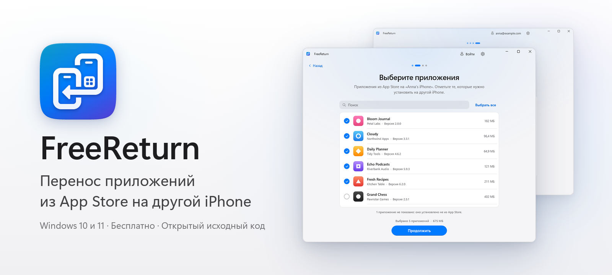
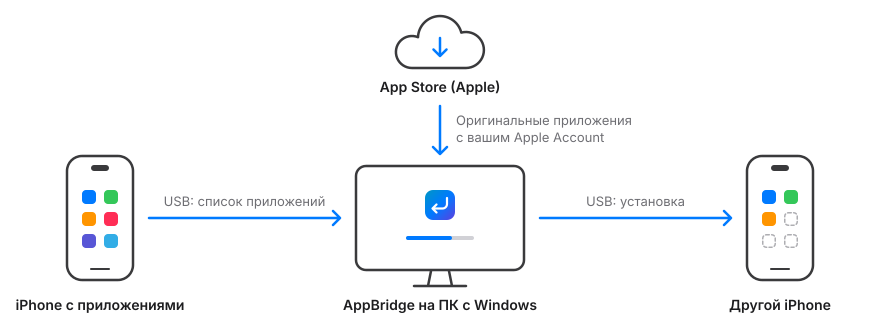
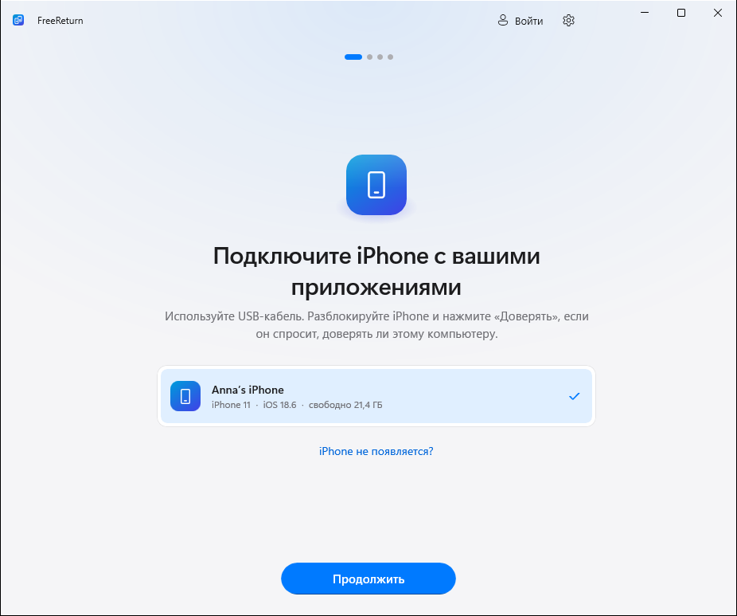
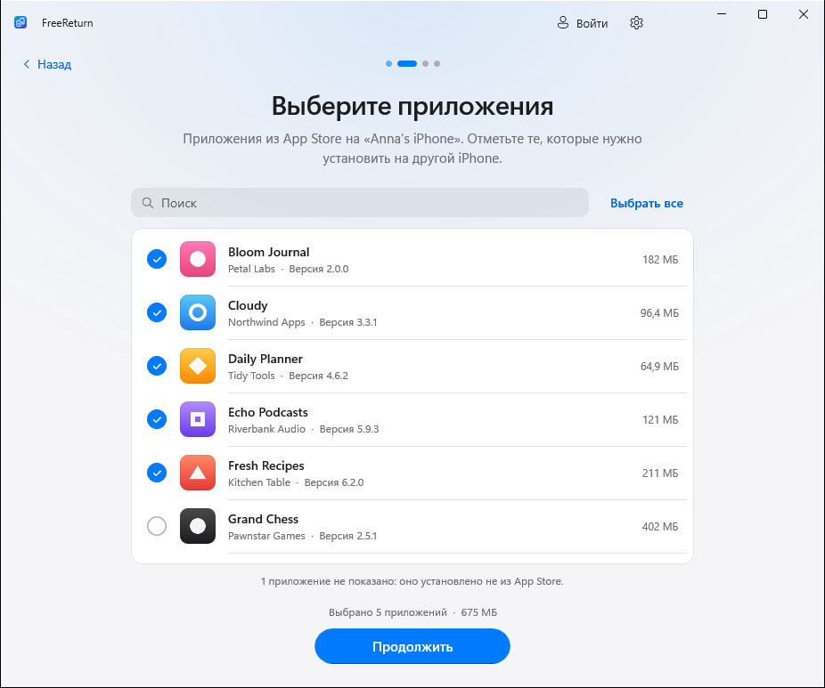
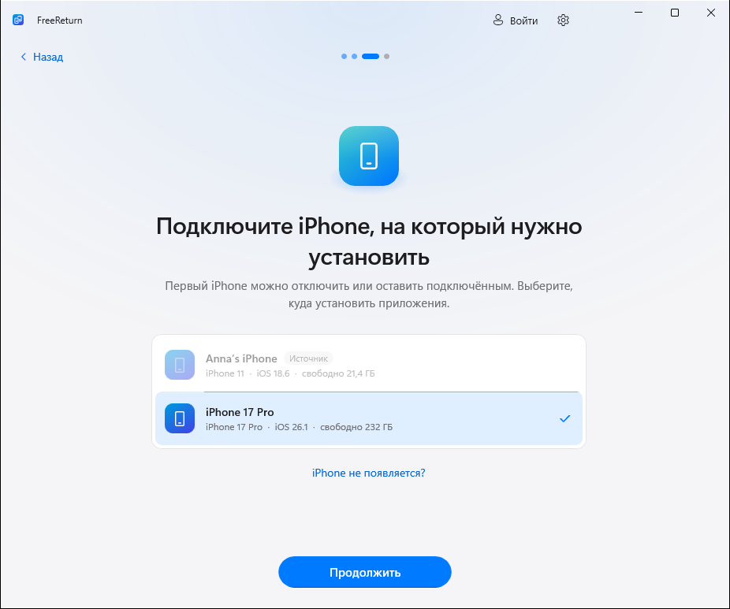
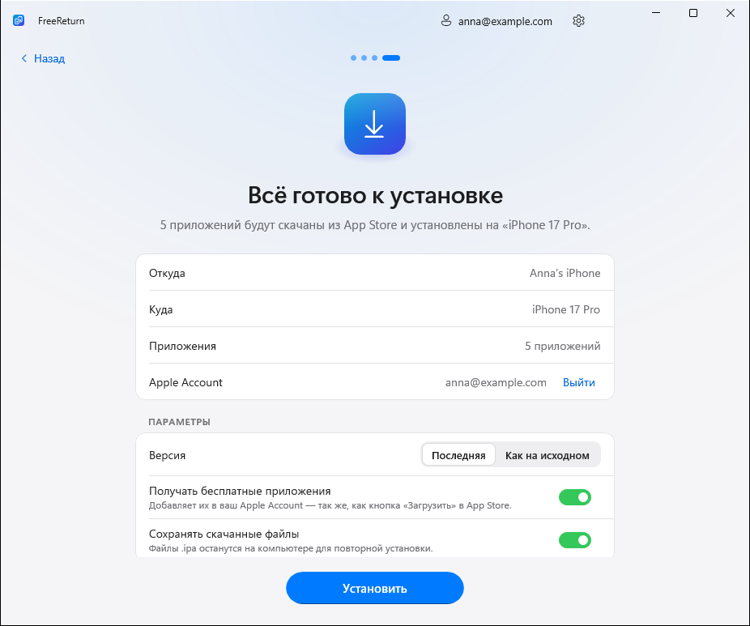
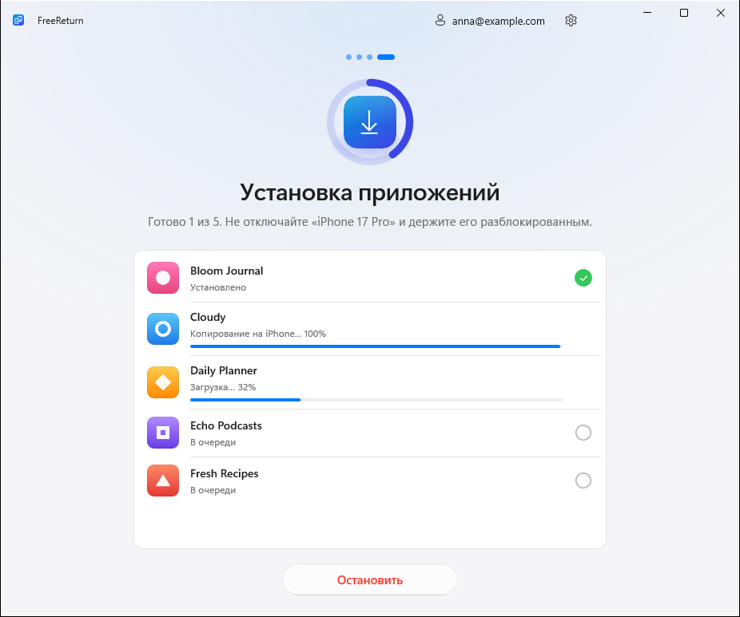
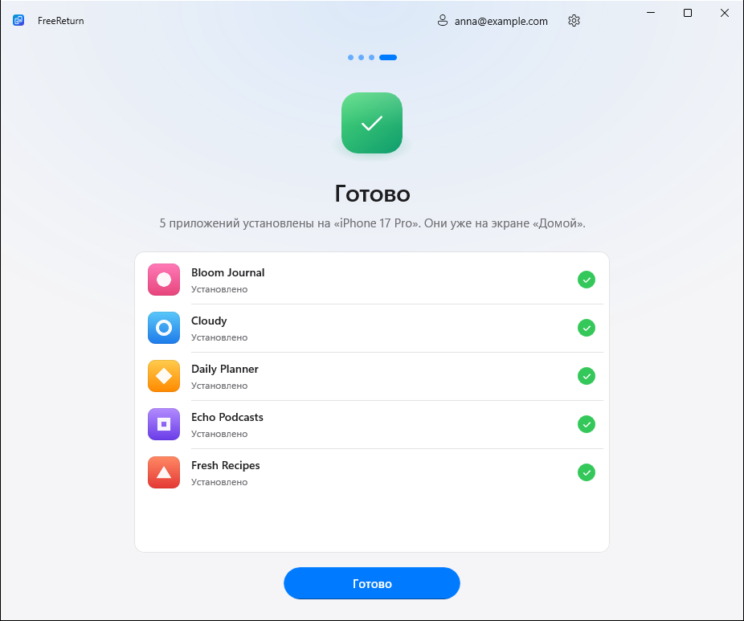

<p align="center">
  <picture>
    <source media="(prefers-color-scheme: dark)" srcset="docs/media/banner-ru-dark.png">
    
  </picture>
</p>

<p align="center">
  <a href="https://github.com/kr0nsch/FreeReturn/releases/latest"></a>
</p>

<p align="center">
  <a href="https://github.com/kr0nsch/FreeReturn/actions/workflows/ci.yml"></a>
  
  <a href="LICENSE"></a>
  <a href="https://github.com/kr0nsch/FreeReturn/releases"></a>
  <a href="README.en.md"></a>
</p>

**FreeReturn** переносит ваши приложения из App Store с одного iPhone на другой прямо с компьютера на Windows. Подключите оба телефона, отметьте нужные приложения и нажмите «Установить» — FreeReturn скачает оригинальные приложения у Apple с вашим Apple Account и установит их по USB. Бесплатно, без джейлбрейка и без рекламы.

<p align="center">
  <picture>
    <source media="(prefers-color-scheme: dark)" srcset="docs/media/demo-ru-dark.gif">
    
  </picture>
  <br>
  <sub>Запись демонстрационного режима: телефоны и приложения смоделированы.</sub>
</p>

## Как это работает

1. **Подключите iPhone с приложениями.** FreeReturn покажет все приложения, установленные из App Store.
2. **Отметьте нужные.** Есть поиск и «Выбрать все».
3. **Подключите второй iPhone.** Оба телефона можно держать подключёнными или подключать по очереди.
4. **Войдите в App Store и нажмите «Установить».** Пока одно приложение устанавливается, следующее уже скачивается.

<p align="center">
  
</p>

## Скриншоты

<table>
  <tr>
    <td width="33%" align="center">
      <picture>
        <source media="(prefers-color-scheme: dark)" srcset="docs/screenshots/ru-dark/1-connect.png">
        
      </picture>
      <br><sub><b>Подключение</b></sub>
    </td>
    <td width="33%" align="center">
      <picture>
        <source media="(prefers-color-scheme: dark)" srcset="docs/screenshots/ru-dark/2-choose-apps.png">
        
      </picture>
      <br><sub><b>Выбор приложений</b></sub>
    </td>
    <td width="33%" align="center">
      <picture>
        <source media="(prefers-color-scheme: dark)" srcset="docs/screenshots/ru-dark/3-target.png">
        
      </picture>
      <br><sub><b>Второй iPhone</b></sub>
    </td>
  </tr>
  <tr>
    <td width="33%" align="center">
      <picture>
        <source media="(prefers-color-scheme: dark)" srcset="docs/screenshots/ru-dark/5-ready.png">
        
      </picture>
      <br><sub><b>Параметры</b></sub>
    </td>
    <td width="33%" align="center">
      <picture>
        <source media="(prefers-color-scheme: dark)" srcset="docs/screenshots/ru-dark/6-installing.png">
        
      </picture>
      <br><sub><b>Установка</b></sub>
    </td>
    <td width="33%" align="center">
      <picture>
        <source media="(prefers-color-scheme: dark)" srcset="docs/screenshots/ru-dark/7-done.png">
        
      </picture>
      <br><sub><b>Готово</b></sub>
    </td>
  </tr>
</table>

## Возможности

- **Четыре простых шага** и одна кнопка на каждом экране.
- **Оригинальные приложения от Apple.** Каждое приложение скачивается с серверов Apple с вашим Apple Account — ничего не берётся со сторонних сайтов.
- **Всё по USB.** Не нужны iTunes, Python и командная строка: FreeReturn сам находит iPhone, показывает запрос «Доверять этому компьютеру?», читает список приложений с иконками и устанавливает их.
- **Быстро.** Скачивание и установка идут параллельно, по каждому приложению видно прогресс, а если что-то не установилось — понятная причина и кнопка «Повторить».
- **Версия на выбор:** последняя из App Store или та же, что на первом iPhone (если Apple её ещё выдаёт).
- **Бесплатные приложения** можно автоматически добавить в ваш Apple Account, если их ещё нет в покупках.
- **Светлая и тёмная тема, русский и английский язык.**
- **Установщик и портативная версия.** Ничего дополнительно ставить не нужно: .NET и Windows App SDK уже внутри.

## Проверено на реальных устройствах

| Откуда | Куда | Приложения | Результат |
|---|---|---|---|
| iPhone 16 Pro | iPhone 14 | Сбер, VK, Почта Mail.ru | ✅ Перенесены |

Проверили на своих устройствах? Расскажите в [issues](https://github.com/kr0nsch/FreeReturn/issues) — добавим в таблицу.

## Скачать

Последняя версия — на странице **[Releases](https://github.com/kr0nsch/FreeReturn/releases/latest)**:

| Файл | Что это |
|---|---|
| `FreeReturn-<версия>-setup-x64.exe` | **Установщик (рекомендуется).** Ставится для текущего пользователя, права администратора не нужны. Ярлык в меню «Пуск» и удаление через «Параметры». |
| `FreeReturn-<версия>-portable-x64.zip` | **Портативная версия.** Распакуйте куда угодно, например на флешку, и запустите `FreeReturn.exe`. Настройки и загрузки хранятся в папке `Data` рядом с программой. |
| `SHA256SUMS.txt` | Контрольные суммы для проверки файлов. |

**Системные требования:** Windows 10 версии 2004 или новее, Windows 11. ПК с процессором x64; на ПК с Arm — Windows 11 (через встроенную эмуляцию).

> [!NOTE]
> Сборки пока не подписаны цифровой подписью, поэтому SmartScreen может предупредить о неизвестном издателе. Нажмите **Подробнее → Выполнить в любом случае**.

## Что понадобится

- **Приложение «Устройства Apple»** из [Microsoft Store](https://apps.microsoft.com/detail/9NP83LWLPZ9K) (или iTunes) — в нём драйвер, через который Windows работает с iPhone. Если его нет, FreeReturn подскажет.
- **USB-кабель** с передачей данных и разблокированные iPhone. На вопрос «Доверять этому компьютеру?» нажмите «Доверять».
- **Apple Account**, которым приложения были получены (или который может получить их бесплатно).
- Подключение к интернету.

## Вопросы и ответы

<details>
<summary><b>Переносятся ли данные приложений?</b></summary>

Нет, FreeReturn устанавливает сами приложения. Документы, переписка и настройки восстанавливаются как обычно — из iCloud, резервной копии или после входа в аккаунт внутри приложения.
</details>

<details>
<summary><b>Какие приложения можно перенести?</b></summary>

Те, что доступны вашему Apple Account в App Store. Бесплатные приложения FreeReturn может сам добавить в ваш аккаунт — как кнопка «Загрузить» в App Store (это можно отключить). Платные должны быть уже куплены этим аккаунтом. Приложения, удалённые из App Store, получится установить, только пока Apple выдаёт их владельцам. Приложения не из App Store (TestFlight, сборки разработчиков) не показываются: их нельзя скачать заново.
</details>

<details>
<summary><b>Безопасно ли вводить пароль Apple Account?</b></summary>

Пароль передаётся напрямую во встроенный открытый [ipatool](https://github.com/majd/ipatool), который входит в Apple. FreeReturn нигде его не сохраняет, не пишет в журналы и никуда больше не отправляет. Сеанс App Store хранится в зашифрованном виде, а ключ защищён Windows (DPAPI) для вашей учётной записи; кнопка «Выйти» удаляет его. У FreeReturn нет своих серверов, рекламы и телеметрии. Подробнее — в [SECURITY.md](SECURITY.md).
</details>

<details>
<summary><b>Нужен ли джейлбрейк? Обходится ли защита Apple?</b></summary>

Нет и нет. Приложения устанавливаются так же, как из App Store, и остаются привязаны к вашему Apple Account (защита FairPlay не обходится).
</details>

<details>
<summary><b>iPhone не появляется в списке</b></summary>

Используйте кабель с передачей данных и подключите его напрямую к компьютеру, разблокируйте iPhone и проверьте, что установлено приложение «Устройства Apple». Попробуйте другой USB-порт.
</details>

<details>
<summary><b>Не исчезает «Нажмите „Доверять“ на iPhone»</b></summary>

Разблокируйте iPhone — запрос показывается только на разблокированном экране. Если вы нажали «Не доверять», нажмите «Повторить» или переподключите кабель.
</details>

<details>
<summary><b>«Нет в покупках этого Apple Account»</b></summary>

Приложение получено другим Apple Account. Войдите под ним или включите «Получать бесплатные приложения» (для бесплатных).
</details>

<details>
<summary><b>Где FreeReturn хранит данные?</b></summary>

| | Установщик | Портативная версия |
|---|---|---|
| Настройки, журналы, сеанс App Store | `%LOCALAPPDATA%\FreeReturn` | `Data\` рядом с `FreeReturn.exe` |
| Скачанные приложения (`.ipa`) | `Загрузки\FreeReturn` (меняется в настройках) | `Data\Downloads` |

В файлах `.ipa` есть email вашего Apple Account (так Apple оформляет покупки) — не передавайте их другим.
</details>

<details>
<summary><b>Что-то пошло не так</b></summary>

Откройте **Настройки → Журналы диагностики → Показать** и приложите последний журнал к [issue](https://github.com/kr0nsch/FreeReturn/issues/new/choose). Паролей и кодов в журналах нет.
</details>

## Сборка из исходников

Нужны Windows 10/11, [.NET 10 SDK](https://dotnet.microsoft.com/download/dotnet/10.0) и [Inno Setup 6](https://jrsoftware.org/isinfo.php) для установщика.

```powershell
# ipatool (закреплённая версия, проверка SHA-256)
./build/Get-Ipatool.ps1

# Тесты
dotnet test tests/FreeReturn.Core.Tests

# Запуск
dotnet run --project src/FreeReturn -p:Platform=x64

# Портативный ZIP и установщик в artifacts/release
./build/build.ps1 -Version 1.0.0
```

Запуск с ключом `--demo` (или с переменной `FREERETURN_DEMO=1`) включает демонстрационный режим со смоделированными iPhone и App Store — удобно для работы над интерфейсом без устройств и Apple Account.

Тег вида `v1.2.3` запускает [GitHub Actions](.github/workflows/release.yml): сборка, тесты и публикация релиза с установщиком, портативной версией и контрольными суммами.

<details>
<summary><b>Структура проекта</b></summary>

| Путь | Что внутри |
|---|---|
| `src/FreeReturn` | Приложение WinUI 3: экраны, модели представления, стили, переводы (`Strings/`) |
| `src/FreeReturn.Core` | Работа с iPhone по USB (доверие, список приложений, установка), интеграция с ipatool, конвейер переноса |
| `tests/FreeReturn.Core.Tests` | Модульные тесты, в том числе проверка с настоящим ipatool |
| `installer` | Скрипт Inno Setup и оформление установщика |
| `build` | Сборка релиза, загрузка ipatool с проверкой контрольной суммы, генерация иконки |
| `legacy/python` | Первый кроссплатформенный прототип на Python (не поддерживается) |

FreeReturn построен на [WinUI 3](https://github.com/microsoft/microsoft-ui-xaml) / Windows App SDK, [Netimobiledevice](https://github.com/artehe/Netimobiledevice) (работа с iPhone по USB) и [ipatool](https://github.com/majd/ipatool) (загрузки из App Store). Лицензии — в [THIRD-PARTY-NOTICES.txt](THIRD-PARTY-NOTICES.txt).
</details>

## Лицензия

[MIT](LICENSE). FreeReturn не связан с Apple Inc. и не одобрен ею. iPhone и App Store — товарные знаки Apple Inc. Используйте программу только с приложениями, на которые у вас есть права.
