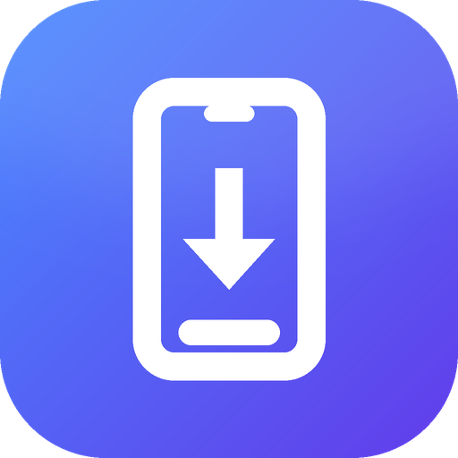
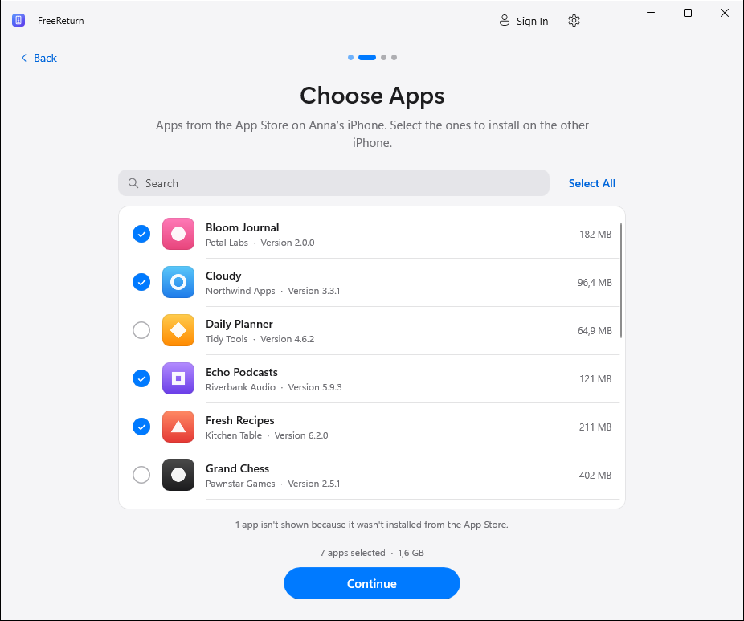
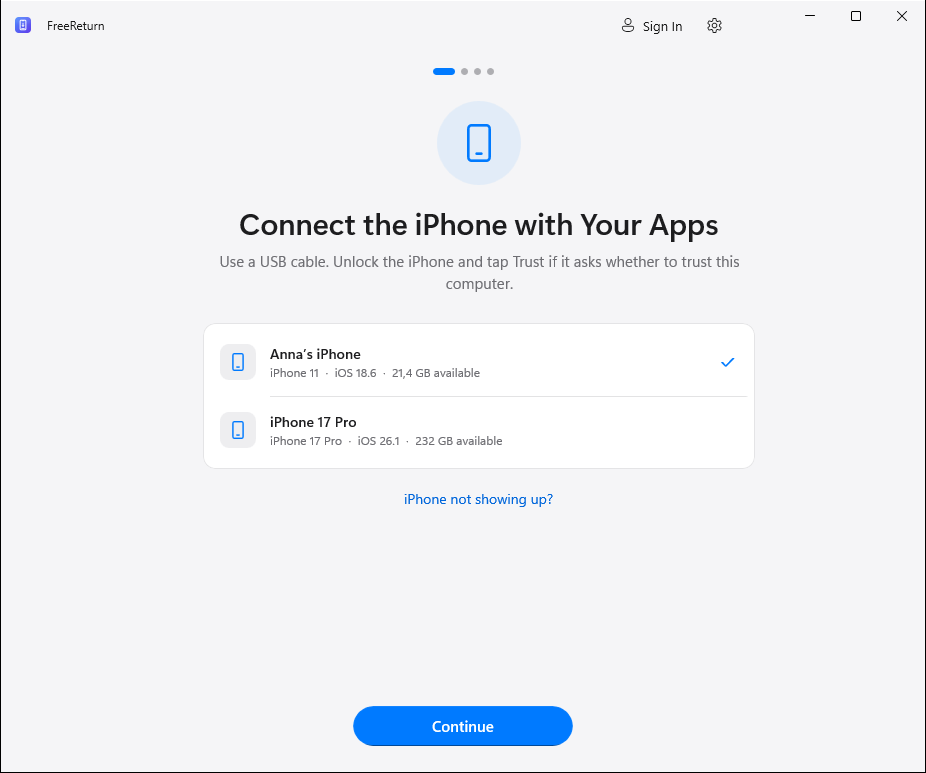
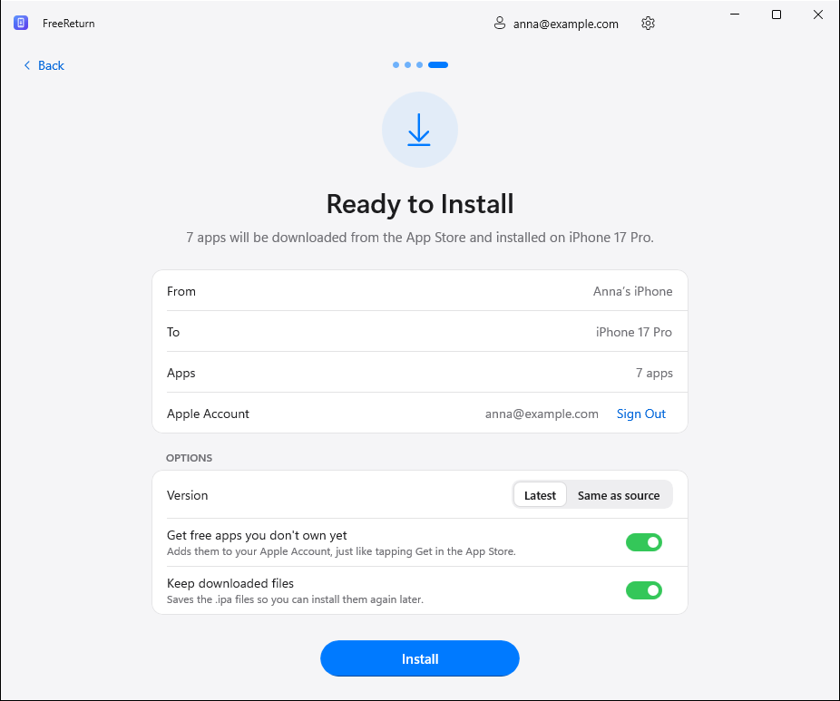
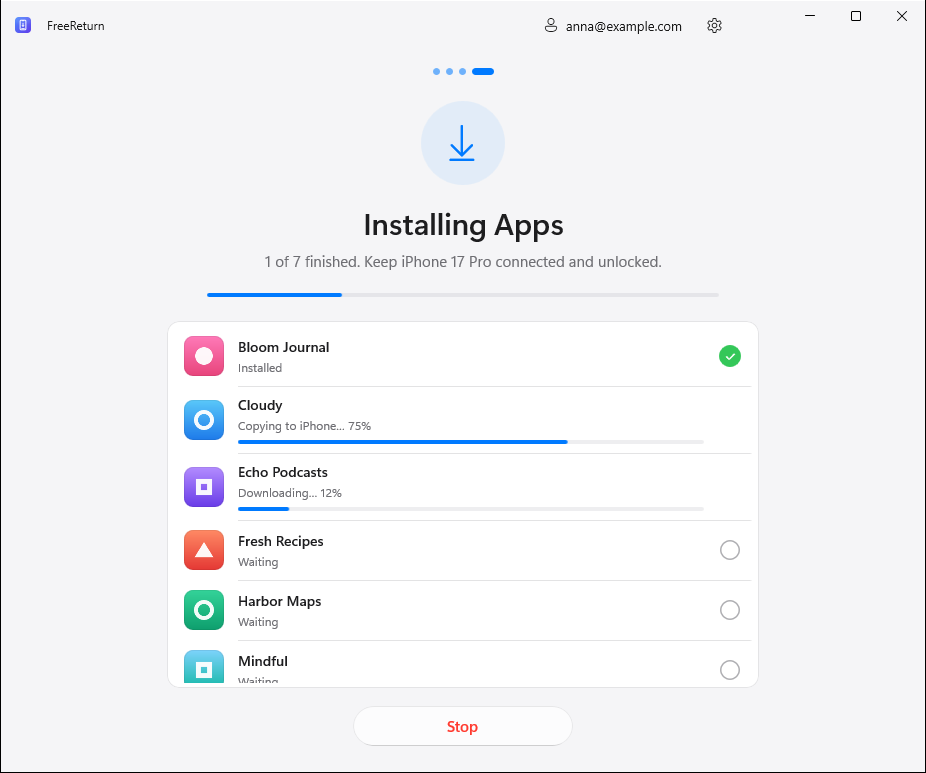

<p align="center">
  
</p>

<h1 align="center">FreeReturn</h1>

<p align="center">
  Copy your App Store apps from one iPhone to another, right from Windows.<br>
  Free, open source, no jailbreak.
</p>

<p align="center">
  <a href="https://github.com/kr0nsch/FreeReturn/releases/latest"></a>
  <a href="https://github.com/kr0nsch/FreeReturn/actions/workflows/ci.yml"></a>
  
  <a href="LICENSE"></a>
  <a href="README.ru.md"></a>
</p>

<p align="center">
  
</p>

## How it works

1. **Connect the iPhone with your apps.** FreeReturn reads the list of apps installed from the App Store.
2. **Choose the apps** you want on the other iPhone.
3. **Connect the iPhone to install on.** Both phones can stay plugged in, or swap them one after the other.
4. **Sign in and install.** Each app is downloaded from Apple with your Apple Account and installed over USB.

The next app downloads while the previous one installs, and you can see the progress of every app.

| | | |
|:-:|:-:|:-:|
|  |  |  |
| Connect | Review and options | Install |

Light and dark mode, English and Russian are built in.

## Download

Get the latest version from **[Releases](https://github.com/kr0nsch/FreeReturn/releases/latest)**:

- **`FreeReturn-<version>-setup-x64.exe`** — installer (recommended). Installs for your user account, no administrator rights needed. Adds a Start menu shortcut and an uninstaller.
- **`FreeReturn-<version>-portable-x64.zip`** — portable version. Unzip anywhere (for example a USB stick) and run `FreeReturn.exe`. Settings and downloads stay in the `Data` folder next to it.

Both run on Windows 10 (version 2004 or later) and Windows 11, on x64 PCs and on Arm PCs through Windows' built-in emulation. Nothing else needs to be installed: .NET and the Windows App SDK are included.

> [!NOTE]
> The builds are not code-signed yet, so Windows SmartScreen may warn that the publisher is unknown. Choose **More info → Run anyway**. You can compare the file with `SHA256SUMS.txt` from the same release.

## What you need

- **The Apple Devices app** from the [Microsoft Store](https://apps.microsoft.com/detail/9NP83LWLPZ9K) (or iTunes). It provides the driver Windows uses to talk to iPhones. FreeReturn tells you if it is missing.
- **A USB cable** that supports data, and both iPhones unlocked. Tap **Trust** when an iPhone asks whether to trust this computer.
- **An Apple Account** that owns the apps, or can get them for free.
- An internet connection.

## Good to know

- **Apps, not data.** FreeReturn installs the apps themselves. Their documents and settings come from iCloud or a backup, as usual.
- **Your purchases only.** Apps are downloaded from Apple with the Apple Account you sign in with. Free apps can be added to your account automatically (you can turn this off). Paid apps must already be bought with that account.
- **Version.** By default the newest version from the App Store is installed. Choose *Same as source* to request the exact version on the first iPhone, if Apple still offers it. Apps that need a newer iOS than the target iPhone has can't be installed.
- **Removed apps.** Apps that were pulled from the App Store can only be installed while Apple still serves them to accounts that own them.
- Apps installed outside the App Store (TestFlight, developer builds) are not shown, because they can't be downloaded again.

## Privacy and security

- Your Apple Account password is passed straight to the bundled, open-source [ipatool](https://github.com/majd/ipatool), which signs in to Apple. FreeReturn never writes it anywhere, never logs it and never sends it anywhere else.
- ipatool keeps its App Store session in FreeReturn's own folder, encrypted with a random passphrase that is protected by Windows (DPAPI) for your user account. **Sign Out** removes it.
- FreeReturn has no servers, accounts, ads or telemetry. The only network traffic is ipatool talking to Apple.
- Downloaded `.ipa` files contain your Apple Account email (Apple adds it to every purchase). Don't share them.
- FreeReturn does not bypass Apple's protection (FairPlay): apps stay tied to your Apple Account, exactly as when installed from the App Store.

Where FreeReturn keeps its data:

| | Installed | Portable |
|---|---|---|
| Settings, logs, App Store session | `%LOCALAPPDATA%\FreeReturn` | `Data\` next to `FreeReturn.exe` |
| Downloaded apps (`.ipa`) | `Downloads\FreeReturn` (changeable in Settings) | `Data\Downloads` |

Found a security problem? See [SECURITY.md](SECURITY.md).

## Troubleshooting

- **The iPhone isn't listed.** Use a cable that carries data, plug it straight into the PC, unlock the iPhone and make sure the Apple Devices app is installed. Try another USB port.
- **"Tap Trust on the iPhone" doesn't go away.** Unlock the iPhone; the Trust prompt only appears on an unlocked screen. If you tapped *Don't Trust*, use **Try Again** or replug the cable.
- **"Not in this Apple Account's purchases".** The app was bought with a different Apple Account. Sign in with that account, or turn on *Get free apps you don't own yet* for free apps.
- **Two-factor code.** After you enter your password, Apple shows a code on your other devices; enter it in FreeReturn.
- **Something else.** Open **Settings → Diagnostic logs** and attach the latest log to an [issue](https://github.com/kr0nsch/FreeReturn/issues). Logs contain no passwords.

## Building from source

Requirements: Windows 10/11, the [.NET 10 SDK](https://dotnet.microsoft.com/download/dotnet/10.0), and [Inno Setup 6](https://jrsoftware.org/isinfo.php) for the installer.

```powershell
# Fetch ipatool (pinned version, SHA-256 verified)
./build/Get-Ipatool.ps1

# Run the tests
dotnet test tests/FreeReturn.Core.Tests

# Run the app
dotnet run --project src/FreeReturn -p:Platform=x64

# Build the portable ZIP and the installer into artifacts/release
./build/build.ps1 -Version 1.0.0
```

Start the app with `--demo` (or set `FREERETURN_DEMO=1`) to use simulated iPhones and a simulated App Store. It is handy for UI work and needs no hardware or Apple Account.

Pushing a tag like `v1.2.3` makes [GitHub Actions](.github/workflows/release.yml) build, test and publish a release with both downloads and checksums.

### Project layout

| Path | Contents |
|---|---|
| `src/FreeReturn` | WinUI 3 app: views, view models, styles, translations (`Strings/`) |
| `src/FreeReturn.Core` | Device access (USB, pairing, installation), ipatool integration, transfer pipeline |
| `tests/FreeReturn.Core.Tests` | Unit tests, including a smoke test against the real ipatool binary |
| `installer` | Inno Setup script and installer artwork |
| `build` | Release script, ipatool download with checksum pinning, icon generator |
| `legacy/python` | The original cross-platform Tkinter prototype (unmaintained) |

FreeReturn is built with [WinUI 3](https://github.com/microsoft/microsoft-ui-xaml) / Windows App SDK, [Netimobiledevice](https://github.com/artehe/Netimobiledevice) for talking to iPhones over USB, and [ipatool](https://github.com/majd/ipatool) for App Store downloads. See [THIRD-PARTY-NOTICES.txt](THIRD-PARTY-NOTICES.txt).

## License

[MIT](LICENSE). FreeReturn is not affiliated with, authorized or endorsed by Apple Inc. iPhone and App Store are trademarks of Apple Inc. Use it only with apps you are entitled to.
