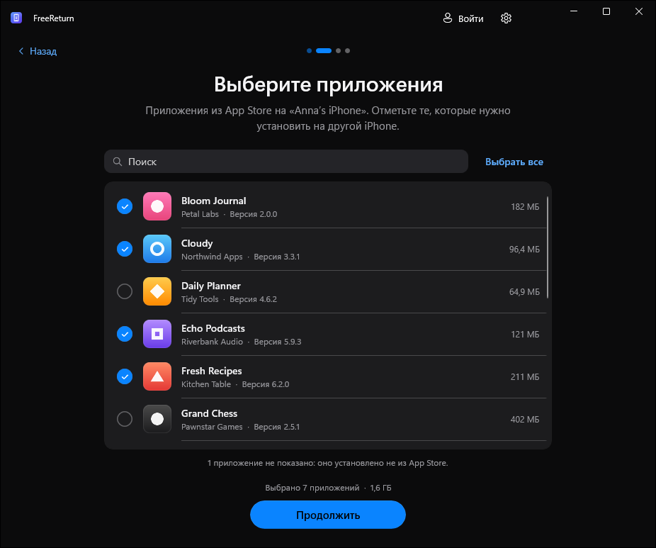

  

<h1 align="center">FreeReturn</h1>

  Перенос приложений из App Store с одного iPhone на другой прямо из Windows. 
  Бесплатно, с открытым исходным кодом, без джейлбрейка.

  
  

  

## Как это работает

1. **Подключите iPhone с приложениями.** FreeReturn прочитает список приложений, установленных из App Store.
2. **Отметьте приложения**, которые нужны на другом iPhone.
3. **Подключите iPhone, на который нужно установить.** Оба телефона можно держать подключёнными или подключать по очереди.
4. **Войдите и установите.** Каждое приложение скачивается у Apple с вашим Apple Account и устанавливается по USB.

Пока одно приложение устанавливается, следующее уже скачивается; прогресс виден по каждому приложению.

## Скачать

Последняя версия — на странице **[Releases](https://github.com/kr0nsch/FreeReturn/releases/latest)**:

- **`FreeReturn-<версия>-setup-x64.exe`** — установщик (рекомендуется). Устанавливает для текущего пользователя, права администратора не нужны.
- **`FreeReturn-<версия>-portable-x64.zip`** — портативная версия. Распакуйте куда угодно и запустите `FreeReturn.exe`. Настройки и загрузки хранятся в папке `Data` рядом с программой.

Работает в Windows 10 (версия 2004 и новее) и Windows 11. Ничего дополнительно ставить не нужно: .NET и Windows App SDK уже внутри.

> [!NOTE]
> Сборки пока не подписаны цифровой подписью, поэтому SmartScreen может предупредить о неизвестном издателе. Нажмите **Подробнее → Выполнить в любом случае**. Файл можно сверить с `SHA256SUMS.txt` из того же релиза.

## Что понадобится

- **Приложение «Устройства Apple»** из [Microsoft Store](https://apps.microsoft.com/detail/9NP83LWLPZ9K) (или iTunes) — это драйвер для работы с iPhone. FreeReturn подскажет, если его нет.
- **USB-кабель** с передачей данных и разблокированные iPhone. На вопрос «Доверять этому компьютеру?» нажмите «Доверять».
- **Apple Account**, которым приложения были куплены (или может получить их бесплатно).
- Интернет.

## Важно знать

- **Переносятся приложения, а не их данные.** Документы и настройки приложений восстанавливаются, как обычно, из iCloud или резервной копии.
- **Только ваши покупки.** Приложения скачиваются у Apple с тем Apple Account, под которым вы вошли. Бесплатные приложения могут добавляться в аккаунт автоматически (это можно отключить). Платные должны быть уже куплены этим аккаунтом.
- **Версия.** По умолчанию ставится последняя версия из App Store. Вариант «Как на исходном» запрашивает ту же версию, что на первом iPhone, если Apple её ещё выдаёт.
- Приложения не из App Store (TestFlight, сборки разработчиков) не показываются: их нельзя скачать заново.

## Конфиденциальность

- Пароль Apple Account передаётся напрямую во встроенный открытый [ipatool](https://github.com/majd/ipatool), который входит в Apple. FreeReturn нигде его не сохраняет, не записывает в журналы и никуда больше не отправляет.
- Сеанс App Store хранится в папке FreeReturn в зашифрованном виде; ключ защищён Windows (DPAPI) для вашей учётной записи. Кнопка **Выйти** удаляет его.
- У FreeReturn нет серверов, рекламы и телеметрии.
- В скачанных файлах `.ipa` содержится email вашего Apple Account (так устроены покупки Apple). Не передавайте их другим.
- Защита Apple (FairPlay) не обходится: приложения остаются привязаны к вашему Apple Account.

## Если что-то не так

- **iPhone не появляется.** Используйте кабель с передачей данных, подключите напрямую к компьютеру, разблокируйте iPhone, проверьте, что установлено «Устройства Apple».
- **«Нажмите „Доверять“ на iPhone» не проходит.** Разблокируйте iPhone — запрос показывается только на разблокированном экране.
- **«Нет в покупках этого Apple Account».** Приложение куплено другим аккаунтом: войдите под ним или включите «Получать бесплатные приложения».
- **Другое.** Откройте **Настройки → Журналы диагностики** и приложите последний журнал к [issue](https://github.com/kr0nsch/FreeReturn/issues). Паролей в журналах нет.

## Сборка из исходников

См. раздел [Building from source](README.md#building-from-source) в английском README.

## Лицензия

[MIT](LICENSE). FreeReturn не связан с Apple Inc. и не одобрен ею. iPhone и App Store — товарные знаки Apple Inc. Используйте программу только с приложениями, на которые у вас есть права.
